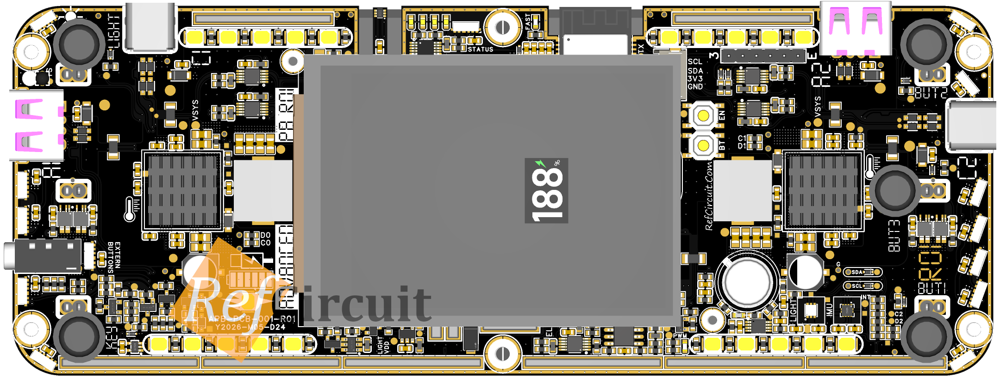
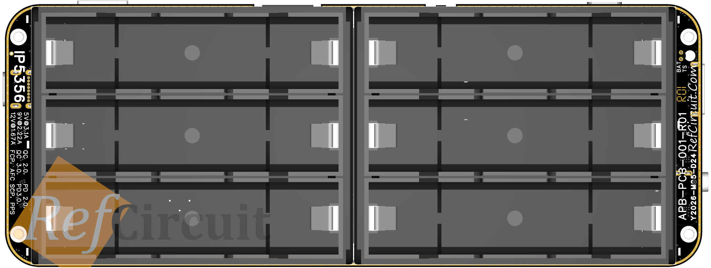
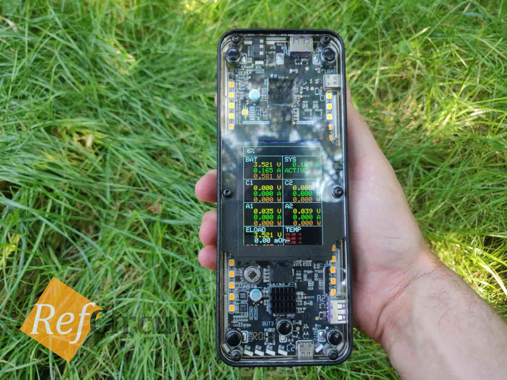
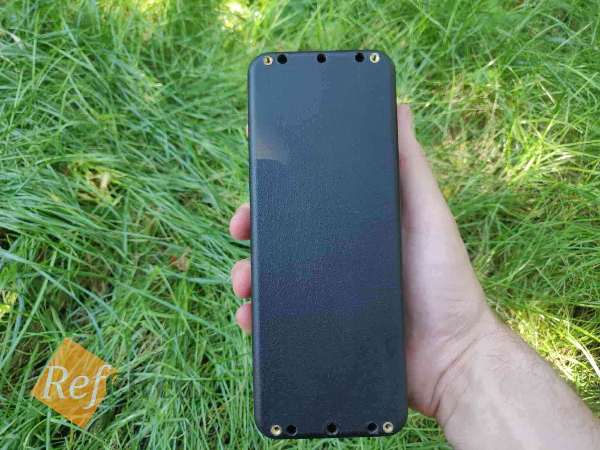
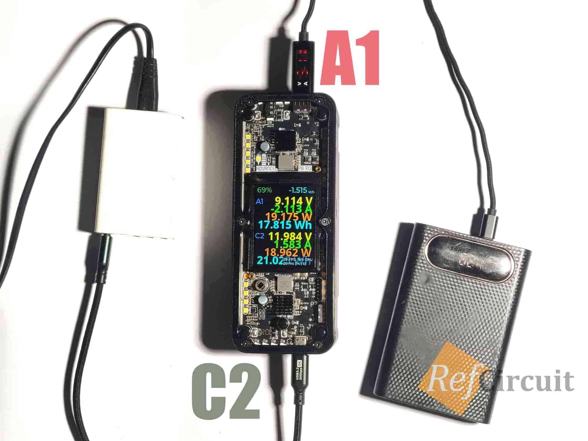
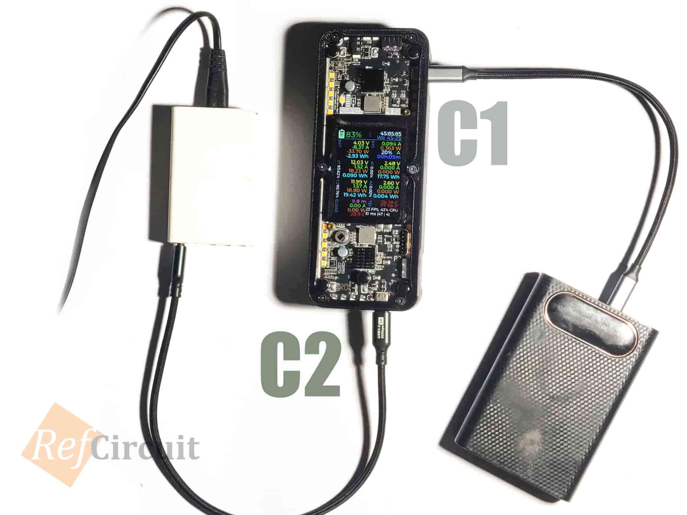

# APB-FRW-001 - Advanced Power Bank Firmware

Firmware for the **APB-PCB-001-R01 Advanced Power Bank** board.

- MCU: ESP32-C6FH4, 4 MB flash
- Framework: Arduino / ESP-IDF via PlatformIO
- Display: ST7789 240x320 with LVGL

This project is the consolidated production-style firmware. It includes the
CLI, LVGL dashboard, power monitoring, battery/energy management, IP5356
control through the I2C mux, FRAM persistence, RGB/buzzer feedback, buttons,
BLE UART, activity timeout, and deep/light sleep support.

## 🥃 3D View

<p align="right">
  
  
</p>

## 📷 Photos

<p align="right">
  
  
</p>

## 🎡 Tests

<p align="right">
  
  
</p>


## 🏈 Features

- Transparent top cover (3mm acrylic) + 3D printed case
- Simultaneously charging (18W) and discharging with fast protocols (22.5W) + seamless UPS (by using two power bank ICs)
- Small heatsink (Al/Cu) for each power IC
- Ability to access to power bank IC settings using I2C
- Independent voltage and current measurements for battery, system and each USB port
- LEDs control using separate button (on/off/change brightness - like flashlight)
- RGBW lights along the perimeter
- Color display for showing real-time electrical parameters: E, P, U, I, T, t, η
- Energy meter (show delivered energy to device) possibility
- Low battery notification (like cellphone) possibility
- Battery diagnostic - programmable electronic load for internal resistance measurement, computing State of Charge (SoC), State of Health (SoH), Run-Time to Empty (RtE)

## 📁 Project layout

```text
src/
  main.cpp                 RTOS task creation
  app/                     application composition and loops
  cli/                     CLI engine and command registry
    commands/              one file per command group
  hardware/                display, RGB, buzzer, FRAM, mux, power, sensors
  services/                battery, energy, time, sleep, BLE, IP5356 manager
  infra/                   I2C bus lock, logger, terminal, serial output
  ui/                      LVGL screens, generated UI, fonts
  sound/                   melody data
include/
  config/                  pins, addresses, timing, display, battery config
  lv_conf.h                LVGL configuration
lib/                       vendored libraries
```

## 📃 Dependencies and libraries

All libraries are vendored under `lib/` so the firmware can be built without
global Arduino library dependencies. Versions below are the versions in this
project.

| Library | Version | License | Upstream / usage |
|---|---:|---|---|
| ESP32 Arduino core / ESP-IDF | PlatformIO `espressif32` | LGPL-2.1 / Apache-2.0 | https://github.com/espressif/arduino-esp32 and https://github.com/espressif/esp-idf |
| LVGL | 9.6.0 | MIT | https://github.com/lvgl/lvgl |
| OneButton | 2.6.2 | BSD-3-Clause | https://github.com/mathertel/OneButton |
| Adafruit NeoPixel | 1.12.2 | LGPL-3.0 | https://github.com/adafruit/Adafruit_NeoPixel |
| Adafruit BusIO | 1.17.4 | MIT | https://github.com/adafruit/Adafruit_BusIO |
| Adafruit GFX | 1.12.6 | BSD | https://github.com/adafruit/Adafruit-GFX-Library |
| Adafruit ST7735/ST7789 | 1.11.0 | MIT | https://github.com/adafruit/Adafruit-ST7735-Library |
| INA226 | 0.6.6 | MIT | https://github.com/RobTillaart/INA226 |
| RTClib | 2.1.4 | MIT | https://github.com/adafruit/RTClib |
| Temperature_LM75_Derived (TMP102) | 1.0.3 | BSD-3-Clause | https://github.com/jeremycole/Temperature_LM75_Derived |
| FRAM_MB85RC_I2C | bundled | BSD | SOSAndroid.fr (upstream URL not bundled) |
| ClosedCube TCA9546A | 1.0.1 | MIT | https://github.com/closedcube/ClosedCube_TCA9546A (vendored; current firmware uses its own I2CMux driver) |
| IP5356 | 1.0.0 | First-party APB code | Register accessor written for this project from the Injoinic IP5356 datasheet |
| PlatformIO Core | 6.1.19 | Apache-2.0 | https://github.com/platformio/platformio-core (build tool, not linked into firmware) |
| Montserrat fonts | generated LVGL tables | SIL OFL-1.1 | https://github.com/JulietaUla/Montserrat |
| Open Sans | generated LVGL tables | Apache-2.0 | https://github.com/googlefonts/opensans |
| DIN 1451 Engschrift font table | generated LVGL table | Source font license not bundled | Verify redistribution terms before publishing; the table is currently not referenced by active UI code |

The full license text for each vendored library is in its directory under
`lib/` (`LICENSE`, `LICENCE`, `COPYING`, `license.txt`, `LICENSE.md`, or the
source header).

## 🔏 Project license

Unless another license is stated in a file or bundled library, this project's
original source code is licensed under the **GNU General Public License v3.0
or later** (`GPL-3.0-or-later`).

This is compatible with the copyleft requirements of the bundled LGPL-3.0
component and keeps the complete firmware open when distributed. The original
MIT, BSD, Apache-2.0, LGPL-3.0, and OFL-1.1 notices for third-party components
remain in effect; they are not replaced by the project license.

See [LICENSE](LICENSE) for the full GPL-3.0 text.

### No warranty

This firmware controls power electronics and lithium batteries. It is provided
without warranty. Verify all safety limits, cell ratings, charger behavior, and
output ratings against the actual hardware before use.
